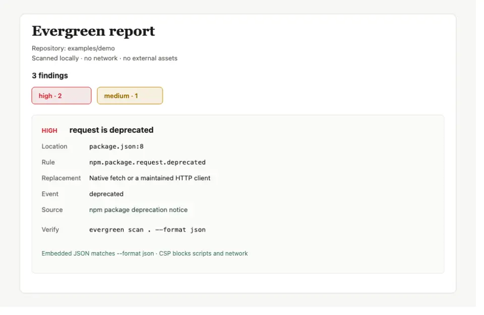
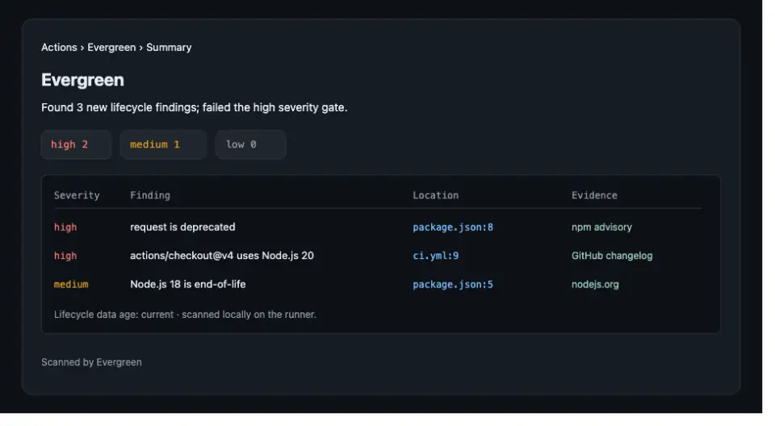
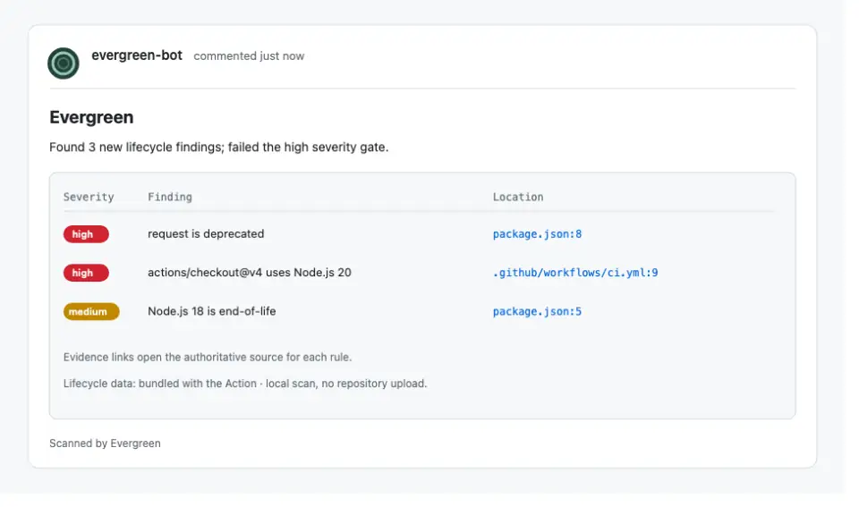
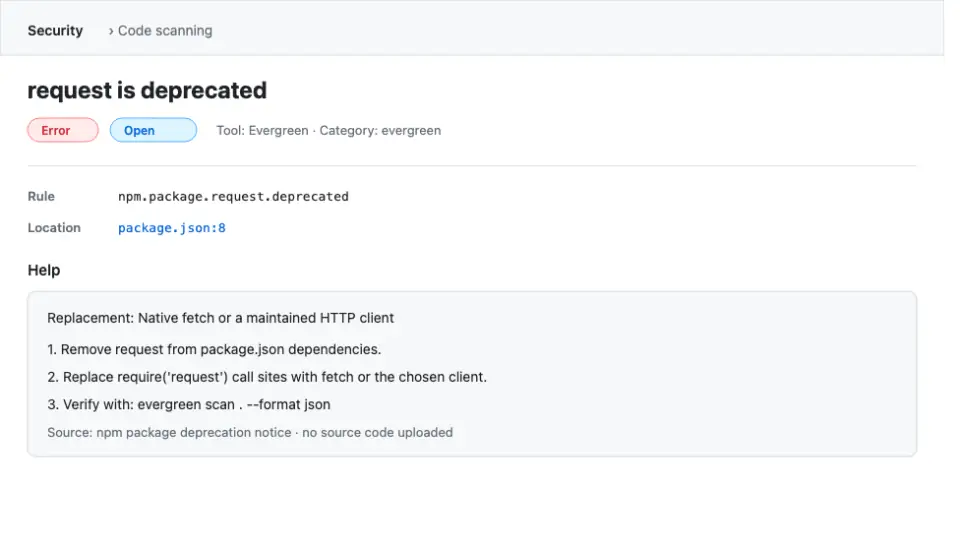
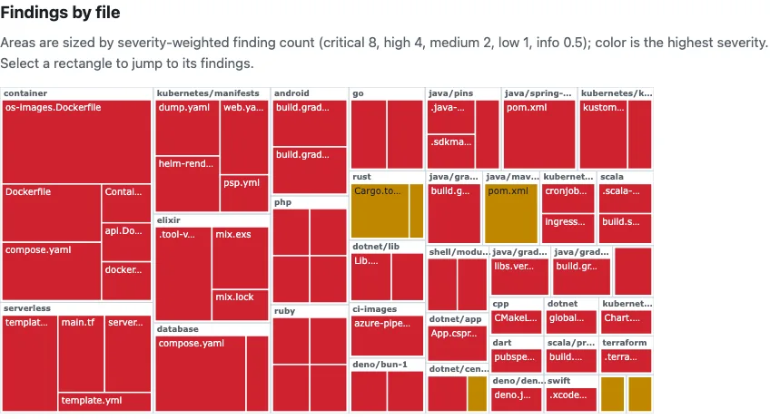

# Screenshots

This kit does not add new screenshots. It reuses the captures that already
document the product under
[`docs/assets/screenshots/`](../assets/screenshots/). Do not recreate, retouch,
or edit a finding count into one of these files; if a post needs a current
capture, regenerate it from the same command and say what changed.

| File | What it shows | Best for |
| --- | --- | --- |
| [`html-report.webp`](../assets/screenshots/html-report.webp) | Self-contained HTML report from `examples/demo`, with finding counts and a high-severity deprecated package | X, Bluesky, thread, general newsletters |
| [`job-summary.webp`](../assets/screenshots/job-summary.webp) | GitHub Actions job summary with severity counts and a finding table | LinkedIn, DevOps and platform newsletters, r/devops |
| [`pr-comment.webp`](../assets/screenshots/pr-comment.webp) | Pull request comment from the Action with the gate result and finding rows | r/devops, CI-focused newsletters |
| [`sarif-alert.webp`](../assets/screenshots/sarif-alert.webp) | GitHub code scanning alert opened from Evergreen SARIF | r/devops follow-up, security or code-scanning sections |
| [`treemap.webp`](../assets/screenshots/treemap.webp) | Findings treemap sized by severity-weighted count and colored by highest severity | Mastodon, visual or data-oriented newsletters |

## Capture details

### HTML report



- It is the output of `evergreen scan --format html` on `examples/demo`, and it
  says so in the header: scanned locally, no network, no external assets.
- The visible finding is the deprecated `request` package at `package.json:8`,
  with its rule, replacement, event, source, and verify command.
- **Alt text:** Evergreen HTML report from the demo project, showing three
  findings with a high-severity deprecated package, its file location,
  replacement, and source.

### GitHub Actions job summary



- Shows the severity gate result, counts for high, medium, and low, and rows for
  a deprecated package, an unsupported Action runtime, and an end-of-life
  runtime.
- **Alt text:** GitHub Actions job summary from Evergreen showing two high and
  one medium finding, with file locations and evidence labels.

### Pull request comment



- Shows the same kind of result as a pull request comment, with links to the
  exact file locations and a note that the scan is local.
- **Alt text:** Evergreen pull request comment listing a deprecated package and
  an unsupported Action runtime, with file locations and a gate result.

### Code scanning alert



- Shows a SARIF finding in GitHub code scanning with the rule, location,
  replacement, ordered steps, and the source note.
- **Alt text:** GitHub code scanning alert titled "request is deprecated" with
  the rule, file location, replacement, and verification steps.

### Findings treemap



- The legend explains the sizing (critical 8, high 4, medium 2, low 1, info 0.5)
  and the color (highest severity in the file).
- **Alt text:** Treemap of Evergreen findings by file, sized by severity-weighted
  finding count and colored by the highest severity in each file.

## Counts can differ

The captures show an earlier state of `examples/demo`. A current scan can report
a different number of findings because the bundled rules change between
releases, and the demo documentation has described four and five findings at
different times. Do not quote the number in the image as a product metric. If a
post needs an exact count, run a fresh scan and recapture instead of editing the
image.

## Refreshing a capture

Use the same commands the documentation uses, then replace the file at the same
path so existing links keep working.

```bash
npm run build
demo="$(node dist/tools/examples.js demo)"
node dist/src/cli.js scan "$demo" --format html > report.html
```

For the treemap, use the treemap section of the same HTML report. The Action
screenshots require a workflow run; the captures under `docs/assets/screenshots/`
are the approved ones, so reuse them rather than staging a fake run.

If a capture changes, update its alt text here and check the pages that already
embed it: [MCP.md](../MCP.md), [GITHUB_ACTION.md](../GITHUB_ACTION.md), and
[SHARE_REPORT.md](../SHARE_REPORT.md).
